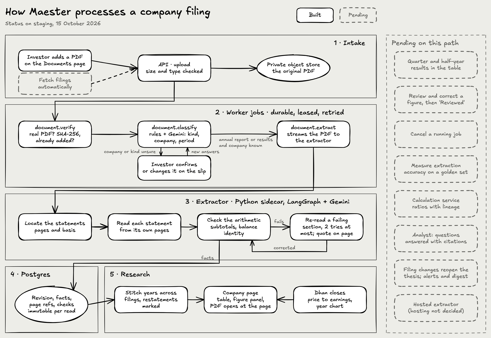

# Building Maester

The [README](../README.md) says what Maester does for an investor. This page is for the people building it: where the build stands, what each roadmap step contains, and where to look to run, change and deploy it.

## Where the build stands

Maester is pre-alpha, part-way through **R1 · A**. Nothing is hosted for investors yet; everything below runs on your own machine, as the [contributing guide](../CONTRIBUTING.md) explains.

How the codebase fits together, with what is built and what is still pending:

How a company filing moves through it:

Both diagrams are Excalidraw files in [`diagrams/`](diagrams/); open one at [excalidraw.com](https://excalidraw.com) to edit it. They were drawn on 15 October 2026, before the XBRL reader, search, the agent tools and the evaluation app landed, and before Claude replaced Gemini as the PDF reader; the lists below are current.

**Working now**

- Sign in with Google or with email and password, behind an invite waitlist. Each account gets a private workspace, and no other workspace can see its companies, documents or jobs.
- **Documents.** Drop annual reports and results as PDFs or XBRL files, one at a time or a whole folder. Maester works out what each file is and which company it belongs to, and groups a filing's PDF and XBRL together. A company it has not seen waits until you confirm it, once. Each filing shows its progress in words, and a step that stops can be tried again on its own.
- **Numbers from the filing.** Figures come from XBRL when the filing has it and are read from the PDF by Claude otherwise (this needs an Anthropic API key). Each fact is versioned and keeps its source page or XBRL element, its period, unit and reporting basis, and the arithmetic checks it passed or failed. Unknown stays unknown, never zero.
- **Research.** A company page with its NSE, BSE and CIN codes, a stock summary (last close, 52-week range, price to earnings, latest revenue and profit), and the profit and loss, balance sheet and cash flow year by year, consolidated and standalone kept apart. Any figure opens a panel saying where it came from, whether it adds up and whether it was restated, with a link to the PDF at that page.
- **Search.** Every page of every filing is read, scanned pages by OCR, and indexed on your own machine. An agent can search it today; there is no search screen yet.
- **Market mood.** How cautious or eager the market is, on a 0 to 100 scale built from 10 readings, with each reading's history. It uses your own Dhan and FRED keys, which you save in Settings and which are stored encrypted.
- **Agent access.** A read-only MCP server lets an agent such as Claude read your filings. Every figure it returns carries its fact id and source.
- **Measurement.** An evaluation harness for extraction and retrieval. The first report, on the XBRL element maps over 807 filings, is in [`eval/`](eval/).
- The public site, the sign-in pages and the error pages, all built on the design system in [DESIGN.md](DESIGN.md).
- The portfolio overview (what is due, headline figures, holdings and allocation) as a read-only demo on a synthetic portfolio. Holdings, Watchlist, Analyst and Activity are coming-soon pages in the terminal.
- The original command-line engine, which extracts a PDF and answers questions about it.

**Not yet**

- No review or correction of a figure. A running job cannot be cancelled.
- Quarterly and half-year results are read but not shown in the statement tables yet.
- Accuracy of figures read from PDFs is not measured; the baseline run is owed. The check that looks for each XBRL figure in its PDF is too weak to trust, so the screens say "Not checked" for now.
- Filings are added by hand; nothing fetches them automatically.
- No calculations, Analyst, notes, holdings, ledger or autonomous monitoring. Broker connections for holdings are on branches that are not merged.

**Next:** close R1 · A with figure review and correction, then start R1 · B with named, versioned calculations, so that a growth rate or a margin is a calculation you can inspect, never a model's arithmetic.

## What each roadmap step contains

The README's roadmap gives each step's investor outcome. This is the scope behind it; the [delivery plan](DELIVERY_PLAN.md) gives each step's exit gate and the [feature roadmap](FEATURE_ROADMAP.md) every feature's acceptance criteria.

| Step | Scope |
| --- | --- |
| **R0** | Workspace, checks, local stack, deploy scripts, design system |
| **R1 · A** (P0) | Sign-in and private workspaces, company records, durable uploads, versioned facts with page provenance, financial tables, source reader |
| **R1 · B** (P0) | Deterministic calculations, evidence-backed Analyst, thesis notes |
| **R1 · C** (P0) | Watchlists, portfolios and accounts, holdings snapshot, portfolio overview, activity and data controls |
| **R1 gate** (P0) | Extraction evaluation, release checklist, five moderated usability sessions, an invited cohort |
| **R2** (P1) | Decimal ledger, tradebook import, reconciliation, dividends and corporate actions, TWR and XIRR, benchmarks |
| **R3** (P1) | Filing and fact-change detection, thesis review triggers, alerts and digests, portfolio-scoped Analyst, income calendar, concentration and drawdown, exports |
| **R4** (P2) | Rebalancing simulation, valuation scenarios, peer comparison, screener, broker connections, multi-currency, funds and ETFs, US filings, sharing, reports, paid plans |
| **P3** | Adviser workflows, tax reporting, factor attribution, backtesting, and execution only as a separately scoped initiative |

## Run it and change it

- **[Contributing guide](../CONTRIBUTING.md)**: ways to contribute, setup, the repository layout, development commands, the engineering rules and the pull request checklist. Start here.
- **[Development](DEVELOPMENT.md)**: the operating manual. Starting the whole stack with Docker, running each service on its own, configuration, local storage and job dispatch, migrations and checks, the CLI, the evaluation harness, connecting an agent, troubleshooting and known limitations.
- **[System descriptions](systems/maester.md)**: the whole system and each app and package, described one at a time.
- **[Documentation index](README.md)**: the product, design and engineering specifications.

## Deploy it

Nothing is hosted for investors yet, and the hosting target is not decided. The deploy scripts in [`infra/`](../infra/README.md) provision a Google Cloud project and deploy the API, worker and web client to it; [sign-in](SIGN_IN.md) section 6 covers the Google OAuth client and the Resend sending domain that a deployment needs. Treat them as a working starting point, not a decision.
